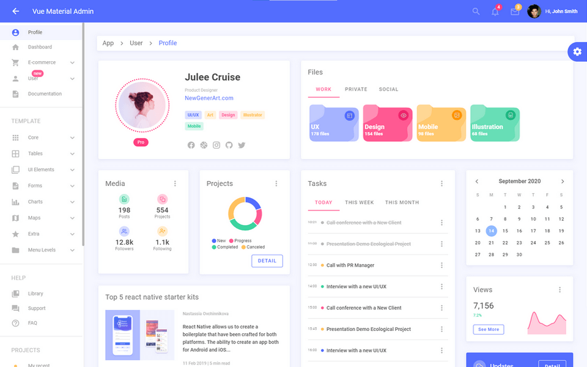

# Vue Material Admin

A Material Design dashboard for Vue with user management, e-commerce screens, charts, data tables and a calendar. Run the standalone demo with sample data or connect the dashboard to an API.

[Live demo](https://flatlogic.com/templates/vue-material-template-full/demo) · [Release notes](changelog.md) · [Flatlogic templates](https://flatlogic.com/templates)

[](https://flatlogic.com/templates/vue-material-template-full/demo)

## Run locally

Use Node.js 22.13 or later in the 22.x line, or Node.js 24 and later.

```sh
git clone https://github.com/flatlogic/material-vue-full.git
cd material-vue-full
npm ci
npm start
```

Open [localhost:3000](http://localhost:3000). The standalone sign-in form is prefilled with the demo account. Its session stays in the browser.

## Connect a backend

Run the [Node.js backend](https://github.com/flatlogic/nodejs-backend), then start the frontend with `npm run start:backend`. Development requests go to `http://localhost:8080/api` by default. For another host, set `VITE_API_URL` to the API base URL in `.env.local`. Sign in with an account from that backend.

| Command | Result |
| --- | --- |
| `npm start` | Start the standalone dashboard locally |
| `npm run start:backend` | Start the dashboard with API authentication |
| `npm run build:demo` | Build the standalone site in `build/` |
| `npm run build` | Build the API-backed site in `build/`; the default production API is `/api` |
| `npm run preview` | Preview the last build locally |
| `npm run lint` | Check the Vue and JavaScript source |

Both builds use hash routing and relative asset paths, so the output can be served from a subdirectory.

## Version 3

Vue 3.5, Vuetify 3, Vue Router 4, Vuex 4 and Vite 7 power the dashboard. All routes use the same URL fragments as version 1. Custom pages extending the old UI need to adopt the Vuetify 3 component and slot APIs. See the [Vuetify upgrade guide](https://vuetifyjs.com/en/getting-started/upgrade-guide/).

## 📦 Pages
- Dashboard
- E-Commerce (Product Management, Product Grid, Product Page)
- User Management (User List, Add, Edit)
- Forms (Validation, Elements)
- Charts (Line, Pie, Bar)
- Tables (Basic, Dynamic)
- Maps (Google, Vector)
- Core (Typography, Colors, Grid)
- Extra (Calendar, Invoice, Gallery, Search Result, Timeline)
- Authentication (Login, Error Pages)

---

## 🌍 Available Variants

|               | **Material**                                              | **Transparent**                                         | **Classic**                                          | **Sofia**                                          | **Flatlogic**                                      |
|---------------|-----------------------------------------------------------|---------------------------------------------------------|-------------------------------------------------------|-----------------------------------------------------|----------------------------------------------------|
| **React**     | [React Material Admin](https://github.com/flatlogic/react-material-admin-full) | [Light Blue React](https://github.com/flatlogic/light-blue-react) | [Sing App React](https://github.com/flatlogic/sing-app-react) | [Sofia React](https://github.com/flatlogic/sofia-react) | [One React](https://github.com/flatlogic/one-react) |
| **Angular**   | [Angular Material Admin](https://github.com/flatlogic/angular-material-admin-full) | [Light Blue Angular](https://github.com/flatlogic/light-blue-angular) | [Sing App Angular](https://github.com/flatlogic/sing-app-angular) | - | - |
| **Vue**       | [Material Vue](https://github.com/flatlogic/material-vue-full) | [Light Blue Vue](https://github.com/flatlogic/light-blue-vue) | [Sing App Vue](https://github.com/flatlogic/sing-app-vue) | - | - |
| **Bootstrap** | - | [Light Blue HTML5](https://github.com/flatlogic/light-blue-html5) | [Sing App HTML5](https://github.com/flatlogic/sing-app-html5) | - | [One Bootstrap](https://github.com/flatlogic/one-bootstrap-template-full) |


Additionally, these templates are tailored for specific business needs:
- [E-Commerce Frontend (React)](https://github.com/flatlogic/ecommerce-frontend) - A complete e-commerce solution.
- [Bookkeeper UI (React)](https://github.com/flatlogic/bookkeeper-ui) - Accounting dashboard for finance management.
- [User Management Template (React)](https://github.com/flatlogic/user-management-template) - User authentication and management.

---

## 👨‍💻 How to Contribute
- **Star this repo ⭐** - show some love.
- **Report bugs** - but be nice.
- **Join the [Discord](https://discord.gg/flatlogic-community)** - meet fellow devs.

---

## 🔥 About Flatlogic
[Flatlogic AI Software Engineer](https://flatlogic.com/ai-software-development-agent) builds modern business software so you don't have to. Our AI Software Development Agent helps you generate, deploy, and maintain enterprise applications with minimal effort.

---

## 📜 License
Released under the [MIT License](LICENSE).

---

> **Questions or feedback?**  
> Join our [Flatlogic Community Discord](https://discord.gg/flatlogic-community) or visit our [support forum](https://flatlogic.com/forum). We might even reply!
